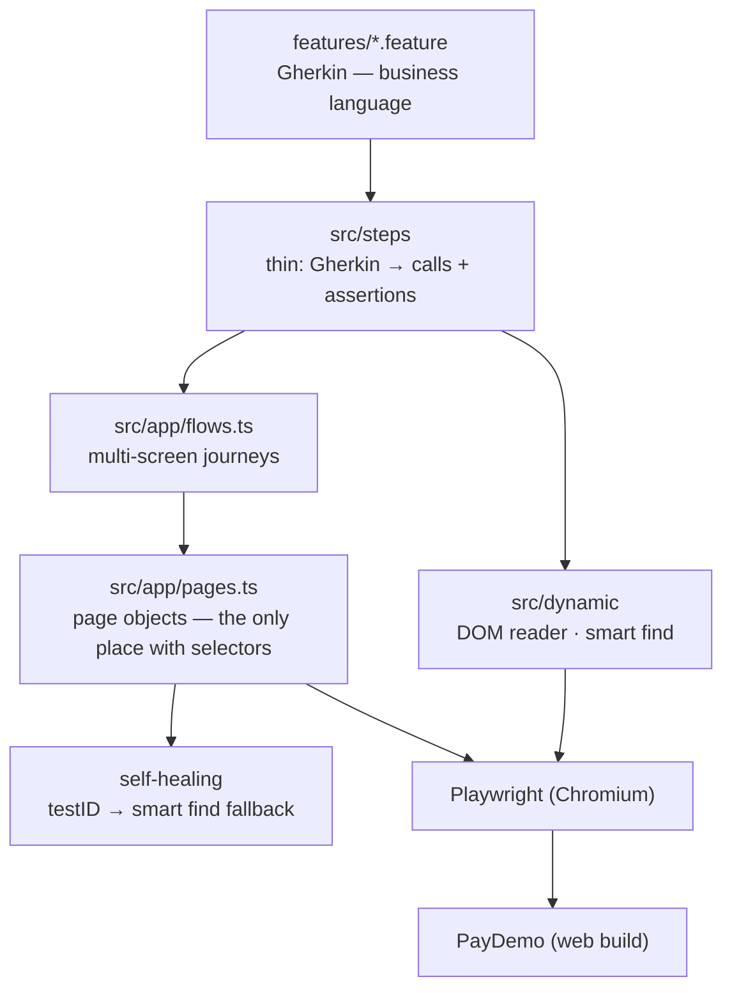
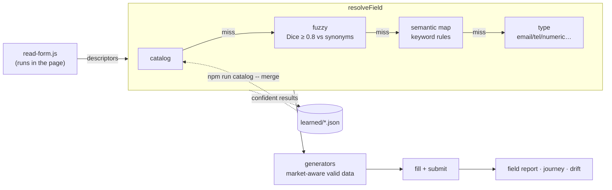

# Architecture

## Test layers

Rules the code follows:

- **Selectors live only in page objects** (or are discovered at runtime by the
  dynamic reader). Steps and flows never contain a selector.
- **No sleeps.** Every wait is a web-first assertion on real state; the
  timeout is configurable (`EXPECT_TIMEOUT`).
- **Independent scenarios.** Fresh browser context per scenario, unique test
  data, preconditions via `?seed=` rather than through the UI.
- **Failures explain themselves.** A full-page screenshot, the URL, browser
  console errors and healing events are attached to the report.

## Dynamic DOM reader

- **Descriptors** come from the live DOM: kind (email/password/tel/numeric/
  choice/text), and label from `aria-label` → a visible text sibling inside
  the field's own container → placeholder.
- **Signature** = `kind|normalised label` is a field's identity across runs.
  It keys the catalog and drift baselines.
- **Learning** is per worker (parallel-safe) and merged afterwards, with hygiene:
  conflicts are kept out, stale entries pruned, ambiguous labels flagged. The
  catalog is committed, so it changes through code review.
- **Drift** compares signatures/keys with `dynamic/baselines/<flow>.json`
  (`UPDATE_BASELINE=1` to refresh).

> Code that runs **inside the browser** (`src/dynamic/browser/*.js`,
> `src/support/hud/hud.js`) is plain JS loaded as text. The TS toolchain
> (esbuild via tsx) injects helpers such as `__name()` that don't exist in
> the page, so `page.evaluate(fn)` with transpiled functions would break.

## Smart find & self-healing

`smartFind(page, "Create account button")` parses an optional role word,
then tries `getByRole` → `getByLabel` → `getByPlaceholder` → `getByText`
(exact, single visible match) → fuzzy matching over accessible names. It
returns the locator, the strategy that worked, and a stable selector
suggestion. Page objects wrap critical actions in `heal(testId, description)`:
the test ID first, then smart find, logging a healing event.

## Testing HUD

`hud.js` is injected with `addInitScript` into a **closed** shadow root, so
Playwright locators, the DOM reader and smart find can't reach it. Buttons
call an exposed binding; the runner's `BeforeStep` hook (no timeout) waits
while paused, runs one step on "Step", opens the Playwright inspector on
"Inspect", and aborts on "Stop".

## Quality measurement

- `npm run kpi` folds the Cucumber message stream into pass rate, flaky
  count (passed only on retry), durations, and results by feature and by risk tag.
- `npm run bug-hunt` runs the suite once per planted bug
  (`app/src/lib/bugs.json`) with retries off, and reports which scenarios caught
  each one. Detection rate is the suite's own quality metric.
- `npm run site` assembles the dashboard (`dashboard/index.html` + data),
  which CI publishes.
