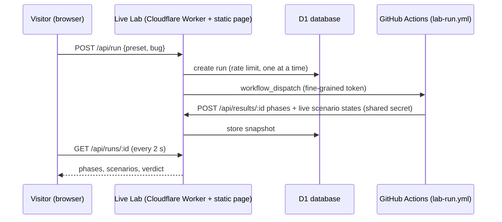

# Live Lab — setup

The Live Lab is a public page where anyone can run the suite in the cloud:
pick scenarios, optionally plant a bug in PayDemo, press **Run**, and watch
each scenario pass or fail live.



Guardrails: presets and bugs come from fixed lists (re-validated in the
workflow; inputs reach shell only via env vars), one run at a time, 5 runs
per IP per hour, the GitHub token can only touch this repo's Actions, and CI
→ Lab updates need a shared secret.

---

## One-time setup (about 15 minutes)

You need three values. Keep them out of chat and out of the repo.

### 1. A shared secret for CI → Lab updates

Generate a random string (PowerShell):

```powershell
-join ((48..57)+(97..122) | Get-Random -Count 40 | % {[char]$_})
```

You'll paste it in two places below as **`LAB_RESULTS_SECRET`**.

### 2. A GitHub token that can only start this repo's workflows

GitHub → your avatar → **Settings** → **Developer settings** → **Personal
access tokens** → **Fine-grained tokens** → **Generate new token**

- **Name:** `qa-agent-lab live`
- **Expiration:** your choice (e.g. 1 year)
- **Repository access:** *Only select repositories* → `qa-agent-lab`
- **Permissions → Repository → Actions:** **Read and write**
  (Metadata: Read-only is added automatically). Nothing else.
- **Generate**, then copy the token. This is **`GITHUB_TOKEN`** below.

### 3. Deploy PayDemo (Cloudflare Worker)

Cloudflare dashboard → **Workers & Pages** → **Create** → **Import a repository** → `Jayet95/qa-agent-lab`

| Setting | Value |
|---|---|
| Project name | `paydemo` (must match `app/wrangler.jsonc`) |
| Root directory | `app` |
| Build command | `npm ci && npx expo export --platform web` |
| Deploy command | `npx wrangler deploy` |
| Build variable | `NODE_VERSION` = `22` |

Result: `https://paydemo.<account>.workers.dev`. Deep links (`/wallet`) work via single-page-app fallback.

### 4. Create the database

**Storage & Databases** → **D1 SQL Database** → **Create** → name `qa-lab`.
Copy its **Database ID** into `lab/wrangler.jsonc` (`database_id`) and push. It is an identifier, not a secret. Tables are created automatically on first use.

### 5. Deploy the Live Lab (Cloudflare Worker)

**Workers & Pages** → **Create** → **Import a repository** → `Jayet95/qa-agent-lab` again

| Setting | Value |
|---|---|
| Project name | `qa-agent-lab-live` (must match `lab/wrangler.jsonc`) |
| Root directory | `lab` |
| Build command | *(empty)* |
| Deploy command | `npx wrangler deploy` |

After the first deploy, open the Worker → **Settings** → **Variables and secrets** → add two of type **Secret**:

| Name | Value |
|---|---|
| `GITHUB_TOKEN` | the token from step 2 |
| `LAB_RESULTS_SECRET` | the string from step 1 |

The D1 binding and `PAYDEMO_URL` come from `lab/wrangler.jsonc`. Note the Lab URL (`https://qa-agent-lab-live.<account>.workers.dev`).

### 6. Tell GitHub where the Lab is

GitHub repo → **Settings** → **Secrets and variables** → **Actions**

- **Secrets** → New repository secret → `LAB_RESULTS_SECRET` = the string from step 1
- **Variables** → New repository variable → `LAB_URL` = the Lab URL from step 5

### 7. Try it

Open the Lab URL → choose **Critical** → plant **`limit-check`** → **Run in the cloud**.
After ~1–2 minutes of setup you should watch 20 scenarios stream in and
see **"🐞 Caught it! … 3 scenarios fail"**.

---

## Local development

```bash
cd lab && npm install && npm run dev        # http://localhost:8788 (Worker + local D1)
```

Without `GITHUB_TOKEN` the Run button is disabled, but you can drive a run
by hand — exactly what CI does:

```bash
cd e2e
export LAB_URL=http://localhost:8788 LAB_RUN_ID=local-demo LAB_RESULTS_SECRET=local-dev-secret REPORT_DIR=reports/lab
curl -X POST $LAB_URL/api/results/$LAB_RUN_ID -H "x-lab-secret: $LAB_RESULTS_SECRET" \
     -H 'content-type: application/json' -d '{"phase":"setup","preset":"critical","bug":"limit-check"}'
npx tsx scripts/lab-stream.ts watch &
BUGS=limit-check RETRY=0 npx cucumber-js --tags "@critical and not @health"
npx tsx scripts/lab-stream.ts final
# open http://localhost:8788/?run=local-demo
```
